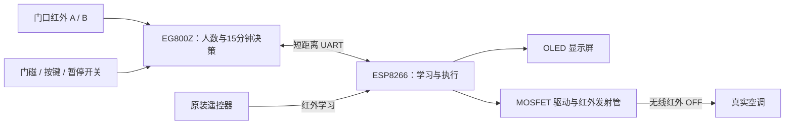

# 栖息 · 宿舍空调助手

**人走了，空调也能按规则关掉。**这个项目用门口两只红外传感器累计人数：最后一人离开、门关好后，持续空房 15 分钟，由设备发出红外 OFF，让空调进入和遥控器关机相同的待机状态。

仓库同时包含 **可操作的网页演示** 和 **等待实物验证的控制器代码**。网页目前使用模拟数据，没有连接真实空调。

[体验演示网站](https://qixi-dorm-ac-demo.beamygala1.chatgpt.site) · [新同伴先读这里](docs/START_HERE.md) · [目前完成了什么](docs/STATUS.md) · [四周计划](docs/planning/宿舍空调项目-给同伴的四周计划.md)

## 先看你要做哪件事

| 你要做什么 | 从这里开始 |
|---|---|
| 看效果、给老师或同伴演示 | [网页使用说明](web/README.md) |
| 改页面、交互、手机桌面与提醒 | [web/](web/) 和 [网页设计说明](docs/web/设计与交付说明.md) |
| 研究人数统计、计时、按键与串口 | [EG800Z 代码](firmware/eg800z/) |
| 研究遥控器学习、红外发射与屏幕 | [ESP8266 代码](firmware/esp8266/) |
| 买材料、接线、安装传感器 | [硬件指南](hardware/README.md) |
| 了解两个人和 AI 怎么分工 | [四周计划](docs/planning/宿舍空调项目-给同伴的四周计划.md) |
| 把网站放到自己的公网地址 | [部署说明](deploy/README.md) |
| 让另一个 AI 继续接手 | [AI 接手说明](docs/AI_HANDOFF.md) |

## 目录怎么分

```text
qixi-dorm-ac/
├─ web/                      可操作的网站演示，可单独运行
│  ├─ dist/                  HTML、CSS、JS、图标和 PWA 文件
│  └─ tests/                 网页状态、设置、通知测试
├─ firmware/                 实物设备的程序基础
│  ├─ eg800z/                QuecPython：计数、计时、最终决策
│  └─ esp8266/               PlatformIO：红外学习、发射、小屏
├─ hardware/                 预算、接线关系、安装位置、待测引脚表
├─ docs/                     新手入口、架构、状态、学习与四周计划
│  ├─ planning/              原始阶段计划与同伴版安排
│  ├─ mindmaps/              思维导图（FreeMind / SVG / PNG）
│  └─ web/                   网页设计和手机提醒方案
├─ tests/firmware/           在电脑上运行的固件逻辑测试
├─ deploy/                   国内托管和静态网站部署说明
└─ tools/                    一键检查与网站打包脚本
```

## 三分钟运行网页

需要 Python 3。在仓库根目录执行：

```sh
python -m http.server 4173 --bind 127.0.0.1 --directory web/dist
```

打开 <http://127.0.0.1:4173>。Windows 也可以双击 `web/启动本地演示.cmd`。不要直接双击 HTML，浏览器模块和桌面缓存需要通过 HTTP / HTTPS 运行。

初次进入选择 4 人寝或 6 人寝，体验红外教程，再设置等待时间。进入“演示控制台”选择“最后一人离开”：等待期间可以提前确认，不确认就到点自动执行。右上角铃铛提供添加桌面、通知授权和测试。

网页里的 1～60 分钟设置、快速场景和提前确认目前只作用于模拟器；实体控制器仍保留至少 900 秒的规则。

## 各部分怎样连接



这是实物的目标连接。网站是独立模拟器，没有接入这条链路；硬件要在现场完成型号、电压、引脚、覆盖范围和真实关机验证。[详细架构](docs/ARCHITECTURE.md)

## 怎么验证代码

安装 Python 3 和 Node.js 22 或更新版本后，在仓库根目录运行：

```sh
python tools/check.py
```

它运行两组已有测试，不需要连接开发板、安装网页依赖或烧录设备。网页使用原生 JavaScript，EG 逻辑测试使用 Python 标准库。

本次整理只改变目录和文档中的路径，保留原有网页和固件行为。具体测试结果与未完成事项见 [项目状态](docs/STATUS.md)。

## 实物完成的标准

真实门口检测、真实 900 秒等待、真实红外发射、真实空调关机四步全部连通，才算完成实物。电脑测试通过、屏幕显示“已发送”，都不能代替现场观察。板卡重启或人数不可信时要重新校准；不要把未知人数当作零。

项目按两人、四周、新增器材约 100 元推进。AI 负责资料、设计、程序和分析，人负责提供实物信息、测量、接线、安装和现场验证；分阶段开始，详细见计划书。
