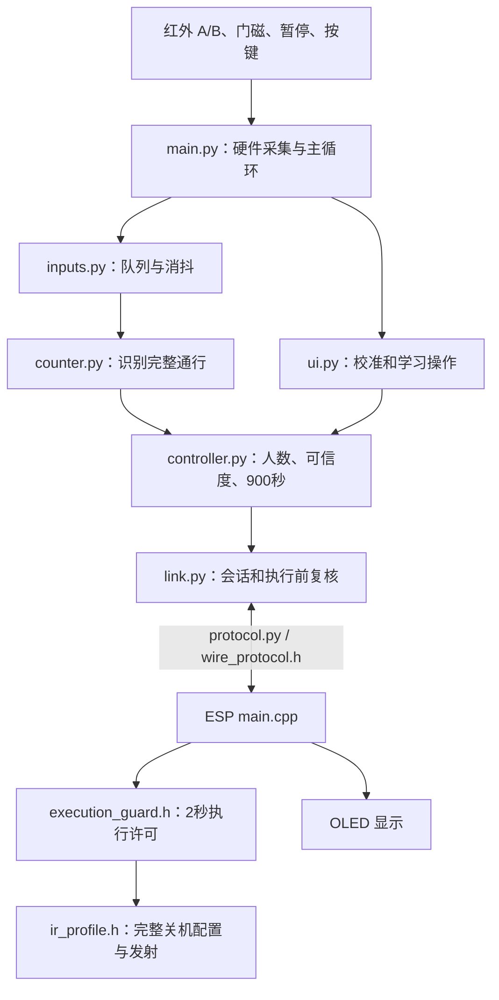
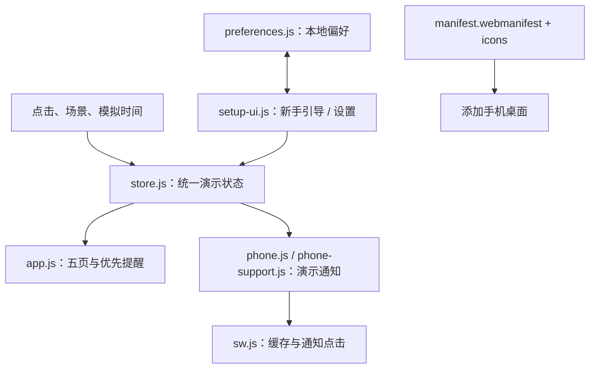

# 架构与代码位置

项目目前有两个可以分别阅读的部分：实物控制器的源码基础，以及用来展示操作流程的网页模拟器。两者尚未联网连接。

## 实物控制器

EG 的 `board_config.py` 还没有填真实引脚。`main.start()` 会先检查配置，未核验时拒绝初始化外设。这是当前正常的起始状态。

计数从人工校准值开始，启动为未知。A/B 完整轨迹结算一次进出；折返、超时、计数下溢、队列溢出等情况会停止可信自动控制。人数为零、门关稳定、空调配置和执行器就绪等条件持续成立后才计时。

## 两板通信

| 事项 | 现有实现 |
|---|---|
| 物理连接 | 短 UART，先核对双方电平，再交叉接 TX/RX |
| 串口参数 | 9600、8N1 |
| 帧 | ASCII JSON + `*` + CRC16/CCITT-FALSE 的四位十六进制 + 换行 |
| 帧长上限 | 384 字节 |
| 会话 | EG / ESP 各自启动标识，重启使旧会话失效 |
| 执行 | EG 准备 → ESP 返回短期标识 → EG 再采样复核 → 提交一次 |
| 重复或过期 | 不发射；ACK 丢失不自动补发 |

JSON 的 `v` 是协议版本，`t` 是消息类型，`e` / `s` 是双方启动标识。具体消息字段以 `link.py` 与 ESP `main.cpp` 对照阅读；目前不用额外设计网站 API。

## 网页模拟器

所有网页运行文件都在 `web/dist/`；这里虽然叫 dist，但它就是当前直接维护的静态源码，不需要构建。测试在 `web/tests/`。

通知点击只返回网页看当前状态，不直接执行 OFF。Service Worker 用于缓存与通知事件，没有后台 15 分钟关机计时器。以后接真设备时仍由现场主控进行最终条件检查，不能让旧网页通知直接驱动空调。
