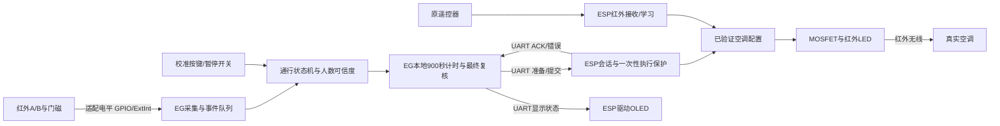

> 仓库整理说明（2026-11-06）：本文保留原阶段计划。网页演示现在已经交付，最新进展见 [项目状态](../STATUS.md)；固件在仓库根目录的 `firmware/`，网页在 `web/`。原文中的“手机页面后置”表示当时的实物优先安排。

# 宿舍空调自动关机项目：AI接手与学习实施指南

> **排期与分工已更新：**用户将周期改为四周。请优先阅读同目录的 [四周实施计划书 v4.0](宿舍空调项目-四周实施计划书-v4.0.md)。本文保留为 v3 技术背景，下面的八周排期及“立即继续实现”的旧提示不再作为当前任务；后续实现由用户到 A1～A5 阶段时明确启动。

版本：v3.0 / 整理日期：2026-10-31  
对象：两名Python入门学生、技术指导老师、后续接手AI。  
用途：保存需求、模块划分、学习路径、接口、现有代码状态和下一步任务。

> 本文依据用户最新确认整理。它描述工程目标和原型实现状态，不代表硬件已搭建或真实空调已关机。若后续用户明确修改需求，以用户的新指令为准，并记录变更。旧v2.0中“真实关机每次确认、断网不执行、全自动仅模拟”的设计已由本次新需求替代，不应无说明地恢复。

## 1. 项目是什么，做到什么算完成

建立独立低压设备：门口双红外识别进出方向 → EG800Z累计人数 → 候选人数为零且条件持续成立15分钟 → ESP8266发射已验证的独立OFF红外指令 → 真实空调进入遥控关机后的待机状态。

### 已确认的需求

| 事项 | 决定 |
|---|---|
| 主控 | EG800Z / QuecPython；唯一现场计数与关机决策者 |
| 红外执行 | ESP8266 / Arduino框架 / IRremoteESP8266 |
| 传感器 | 首版E18-D80NK×2＋干接点门磁，单侧安装 |
| 出入口 | 当前描述约一人多宽；门向宿舍内开；优先固定在门锁侧 |
| 自动关机 | 全天、本地、连续900秒；无需每次人工确认；断网继续 |
| 首次配对 | 能取得原遥控器；学习并现场验证该空调的OFF；更换空调重新学习 |
| 用户界面 | 本地OLED、三个按键、独立暂停开关；手机App/PWA后置 |
| 预算 | 新增器件约100元；电源、数据线、万用表、焊接工具借用 |
| 人员/周期 | 沿用两人、八周；硬件H、软件S，姓名未提供 |
| 首版边界 | 单人依次通行的竞赛实物原型，不承诺复杂并排/紧跟场景可靠识别 |

### 三个不能混淆的概念

1. **无人候选**：从校准的实际人数出发，累计进出后得到0。不是“很久没检测到运动”。
2. **指令发送完成**：ESP已经发出红外波形。不等于空调已经收到或关闭。
3. **真实关机验收**：现场观察到空调达到与原遥控器关机相同的状态。首版没有自动获取空调内部状态的反馈接口。

关机是进入待机，不是切断市电。不拆空调、不改220V线路、不用继电器强制断开压缩机。

## 2. 当前到底完成了什么

项目源码现在位于仓库根目录的 `firmware/`；电脑测试位于 `tests/firmware/`。

| 层次 | 当前证据 | 不应声称 |
|---|---|---|
| 需求/架构 | v3.0方案已经用户确认 | 不代表可直接无人值守安装 |
| EG源码 | 已写采集、状态机、计时、界面、串口和板卡配置模块 | 未在实际EG800Z固件运行验证 |
| ESP源码 | 已写学习、持久化、发射、OLED、串口和执行保护 | 尚无完整编译成功证据，也未烧录 |
| 电脑测试 | 上一执行阶段 `unittest` 49项通过 | 不是49项硬件测试；不代表实际准确率 |
| 工具链 | 已在工作区安装PlatformIO Python工具；ESP依赖下载曾中断/缓慢 | 不能当成编译或固件产物已完成 |
| 硬件 | 用户已有EG800Z，尚未上机；其他器材待采购确认 | 不虚构购买记录、GPIO编号或电压 |
| 真实空调 | 型号/协议尚不清楚，原遥控器可取得 | 不能承诺所有品牌兼容或OFF成功率 |

已存在的核心文件：

```text
qixi-dorm-ac/
  firmware/eg800z/
    board_config.py  # 实物版次、引脚、电压待填；默认拒绝未知接线
    main.py          # QuecPython硬件适配、采集循环、看门狗
    inputs.py        # 有界队列、消抖、长按/组合键
    counter.py       # 完整通行状态机
    controller.py    # 人数、可信度、计时与最终许可
    timebase.py      # 毫秒计时回绕处理
    protocol.py      # UART编码、CRC与流解析
    link.py          # 心跳、会话、准备/提交/取消
    ui.py            # 校准与学习向导、小屏文字
  firmware/esp8266/
    platformio.ini
    src/main.cpp
    include/wire_protocol.h
    include/execution_guard.h
    include/ir_profile.h
  tests/firmware/test_system.py
```

### 后续AI先检查的工程问题

- 先完成ESP真实编译，核对依赖版本、API、内存和Flash大小，不能用Python测试代替C++编译。
- 补测试覆盖学习/保存/中途断电/旧心跳状态。尤其检查：已配对设备重新进入学习时，旧的 `VERIFIED` 状态是否会使界面过早退出学习。
- 检查串口消息批次、主循环阻塞时间、队列积压和最终COMMIT前的输入复核；电脑逻辑通过并不证明时序在板上成立。
- 对未知协议、多段空调帧、接收缓存和载波确认做实际验证；录到一段脉冲不代表完整关机指令。
- 校验实际QuecPython的Pin/ExtInt/UART/WDT支持情况及引脚复用。当前 `BOARD_VERIFIED=False` 是待配置状态，不应通过随便填值绕过。

## 3. 六个模块：学什么、怎么做、怎么接

### M0：基础环境与低压供电

**学习清单**：Python变量/函数/模块/异常；串口日志；电压、电流、GPIO逻辑电平、上拉、共地；QPYcom上传与运行；Arduino/PlatformIO编译下载；万用表测量。

**实现路径**：

1. 记录EG模组完整型号、开发板版次、固件信息；从官方规格确认排针。
2. 用QPYcom完成REPL、`hello world`、脚本上传和停止。
3. ESP独立完成点灯或串口打印。
4. 测电源与GPIO电压，建立接线表；区分板卡供电电压和GPIO输入容许电压。
5. 分别接传感器、按键、串口，最后整合，避免一开始全接上无法定位问题。

**位置/连接**：两块板放门内固定墙面的同一控制盒，高约1.3～1.5米。低压电源供各器件，信号按实测电平适配。不得将未核验的5V输出直接接EG或ESP输入。

**交付**：板卡信息、实际针脚、电压记录；两块板可重复运行最小程序。H负责硬件与供电，S负责EG工具和日志。

### M1：双红外和门磁采集

**学习清单**：漫反射检测、灵敏度与背景干扰；NPN输出/干接点；光耦、电平转换；GPIO中断；触发与释放边沿；时间戳；消抖；有界队列。

**实现路径**：先让A单独被遮挡时输出变化，再加B，再加门磁；记录每次原始变化；完成消抖；在门口调整支架并记录通行轨迹。

**安装**：两只E18都在门锁侧的固定支架上，沿前进方向一前一后，初值高0.9～1.1米、间距20厘米。A靠走廊，B靠室内，均朝通道另一侧。不要上下摆放，不装在移动门板上。门磁固定端在门框，磁铁在门板对应位置。

**接口**：A/B/门磁 → 适配电路 → EG GPIO/ExtInt → 原始事件 `(source, active, monotonic_ms)` → 队列 → 主循环。中断内不做打印、写Flash或复杂计数。

**初值**：传感器消抖10ms、按键30ms、队列128项。实测后记录参数变更；队列满必须进入异常。

**验收**：深浅衣服、靠两侧和中间均可检测；单独开关门20次不计人。E18标称距离不是现场保证，远侧漏检或门板干扰无法消除时先改布设/选型。

### M2：通行识别、累计人数与校准

**学习清单**：有限状态机；顺序/重叠/释放；超时、折返、异常；事件唯一性；电脑轨迹回放与单元测试。

**实现路径**：电脑输入人工轨迹 → 完整进出识别 → 人数增减 → 未知与不可信状态 → 移植EG → 用真实记录回放复现错误。

`AB`表示A、B是否触发，1为检测到人：

| 完整轨迹 | 判定 |
|---|---|
| `00→10→11→01→00` | 进入，+1 |
| `00→01→11→10→00` | 离开，−1 |
| `00→10→00→01→00` | 无重叠的完整进入 |
| `00→01→00→10→00` | 无重叠的完整离开 |
| 同时起始、折返、只过一只后超时 | 歧义，不修改人数，标记不可信 |

完整通行超时初值3秒；重复电平不重复结算。人数0又发生离开是异常，1→0是正常。初始人数未知，禁止随便初始化为0；也不在凌晨自动归零。

**校准**：长按确认进入校准；＋/－调整实际人数；确认保存。正常使用不需要每次出门按键。重启或计数异常后重新校准；通道正被占用或轨迹未结束时不接受校准。

**输出**：`count`、`trusted`、`reason`、`state_version`。供M3判断，供M5显示。人数上限99是程序校验范围，不代表宿舍有99人。

**验收**：100次正常单人通行逐次对账；折返等异常必须留原始记录；不能只展示修正后的最终人数。

### M3：连续15分钟与本地自动决策

**学习清单**：非阻塞循环、单调计时、计数器回绕；资格条件；状态版本；取消；一次性动作；故障恢复。

**起点**：人数已校准且可信、count=0、门关稳定2秒、自动开关开启、ESP在线、关机配置已验证，同时成立时开始。取较晚满足条件的时刻，绝不早于人数归零后15分钟。

**实现路径**：先让屏幕显示剩余秒数 → 加入进入/开门/暂停取消 → 加入串口和配置条件 → 到期复核 → 发放一次执行许可。使用 `ticks_ms/ticks_diff`；不能 `sleep(900)`。

**行为**：

- 任一路新的通行触发先取消计时，再等待完整计数结果。
- 开门、手动暂停、计数异常取消当前计时。
- EG重启回未知；ESP重启/失联作废旧许可，恢复后重新计时。
- 断网不影响本地逻辑。
- 同一次空房只尝试一次；没有ACK不盲目补发；不会自动开机。

**接口**：M2人数/可信度＋M1门磁＋M5暂停/执行器状态 → M3资格判断 → M5执行握手。

**验收**：899秒返回可取消；900秒前不发；时钟回绕不提前执行；持续空房不周期性重复发射。

### M4：空调首次学习、配置保存与真实红外执行

**学习清单**：940nm发射与解调接收；载波频率；空调完整状态帧；幂等OFF与POWER_TOGGLE；MOSFET限流驱动；IRremoteESP8266；LittleFS；校验与断电恢复。

**实现路径**：接收原遥控器两次OFF → 对比捕获 → 按识别出的协议发完整帧，或对未知协议做完整原始时序回放 → 现场验证 → 保存配置。已知协议优先；原始回放的载波不能由普通解调头直接测得，必须另行确认/验证。

**首次学习现场流程**：

1. 进入学习模式；自动关机暂停，旧配置不自动重新获准。
2. 用原遥控器建立已知开机状态，捕获关机码两次，按需要重建原遥控器状态。
3. ESP试发，观察开机状态是否能关。
4. 空调已关时再次试发，确认不会重新开机。
5. 用原遥控器设置其他原运行模式，再试发OFF。
6. 本地确认这些观察，保存验证配置；退出学习后重新校准人数。

软件中的“验证”记录的是操作者现场确认，不是设备自动识别出空调关机。只有切换键、录波不完整或效果不稳定，均不能登记为自动执行配置。

**安装/电路**：接收头在控制盒正面；发射头靠近空调接收窗，初值5～15厘米，不能挡住原遥控器。EG与ESP同盒短串口，发射头沿墙低压引线远置。

```text
5V → 暂停开关的一组触点 → 100Ω → 红外LED → MOSFET漏极
MOSFET源极 → GND
ESP GPIO14 → 100Ω → MOSFET栅极；栅极经100kΩ接地
```

这是一组近距离发射起始参数，需要按所购器件、电流和实际线长复核。不要直接以GPIO承担远距离红外LED驱动。

**输出**：发送阶段、错误原因、配置编号。`ir_tx_finished` 不更新为 `ac_actual_state=off`。

### M5：UART、本地交互和联调验收

**学习清单**：TX/RX交叉连接、UART波特率和电平；帧边界、CRC、流式解析；启动会话、心跳、命令编号；两阶段执行；I²C OLED；按键长按与组合键。

**实现路径**：先两板收发短文本 → 加帧校验 → 加心跳与重启会话 → 加准备/提交/取消 → OLED显示EG权威状态 → 校准及学习向导 → 故障注入。

**物理连接**：

| 信号 | 连接 |
|---|---|
| EG实际TX | 电平适配 → ESP GPIO12软件串口RX |
| ESP GPIO16软件串口TX | 电平适配 → EG实际RX |
| 地参考 | UART两侧建立正确参考地 |
| OLED SDA/SCL | ESP GPIO4 / GPIO5，核验模块电压和I²C地址 |
| 红外接收/发射控制 | ESP GPIO13 / GPIO14 |
| 三个按键 | EG三路输入；按实际逻辑电压上拉 |
| 暂停开关 | 双刀触点：一组断开发射LED供电；另一组供EG读取运行/暂停 |

GPIO均为芯片编号，不能混同NodeMCU的D标号；EG具体排针和UART编号留待实物核验。现有ESP工程默认NodeMCU v2，换开发板后核对PlatformIO配置。

**协议v1**：9600 / 8N1；ASCII JSON正文＋`*`＋4位CRC16/CCITT-FALSE＋换行；最大384字节。CRC用于传输差错检测，不提供密码学身份认证；首版没有网络控制入口。

| 类型 | 方向 | 作用 |
|---|---|---|
| h / H | EG→ESP / ESP→EG | 带新鲜序号的心跳；同步ESP启动会话、配对状态 |
| P / R | EG→ESP / ESP→EG | 准备关机；返回最多有效2秒的临时标识 |
| C | EG→ESP | 最终条件复核后的提交；ESP先消耗标识再发射 |
| X | EG→ESP | 取消尚未执行的准备 |
| A / E | ESP→EG | 发射阶段应答或错误 |
| L | EG→ESP | 本地学习、试发、人工观察确认、保存或退出 |
| S | EG→ESP | 小屏显示内容，由EG提供 |

EG心跳约每秒一次，失联阈值3秒；EG准备/提交窗口1.5秒，ESP临时标识窗口2秒。具体串口时序仍需板上验证。发射已经开始后无法撤回脉冲。

**交互**：正常模式长按确认校准；同时长按＋/－进入学习；学习时＋试发、确认记录观察、－切换原始回放候选载波，长按确认退出。ESP工程初版小屏使用英文短标签，文档/说明使用中文。首次空Flash需按源码的USB `FORMAT_FS`流程初始化，仅在EG断连时进行，会清空原配对数据。

## 4. 整体连接与数据流



这里没有“空调→设备”的状态反馈箭头。传感器检测用的红外和遥控关机用的红外是不同用途的两套电路。

软件交接时固定最小接口：

```text
原始事件：source / active / monotonic_ms
人数状态：count或未知 / trusted / reason / state_version
关机资格：count==0 / trusted / door_stable / armed / esp_ready / profile_verified
串口上下文：v / t / e(EG会话) / s(ESP会话) / id / p(配置) / k(临时标识)
空调配置：protocol / bits / state或value / raw / khz / verified / attestations / checksum
执行结果：result_unknown 或 ir_tx_finished；真实状态保持unknown
```

## 5. 学习与实施排期

| 周 | H：硬件与ESP | S：EG与测试 | 周末可见结果 |
|---|---|---|---|
| W1 | 查板卡、测供电、ESP下载 | EG REPL、Python日志、源码工具 | 最小脚本可运行；引脚表待核项清楚 |
| W2 | 遥控器接收、驱动、真实OFF | 学习记录、配置与接口联调 | 真实空调可被ESP关闭，重复OFF不开机 |
| W3 | 门口支架、A/B/门磁标定 | 原始事件记录和回放 | 通道覆盖和门板干扰实验结果 |
| W4 | 采集稳定性与按键 | 计数、未知/异常、校准 | 正常进出与异常案例可复现 |
| W5 | 串口、小屏、发射头位置 | 900秒计时、一次性许可 | 本地完整15分钟真实关机 |
| W6 | 固定安装、断线/断电试验 | 会话、重复消息和取消测试 | 故障不会恢复旧关机任务 |
| W7 | 白天/夜间、实际线长测试 | 对账、日志、修复缺陷 | 实测证据及剩余限制 |
| W8 | 实物照片、接线和安装图 | 手册、代码版本、答辩和视频 | 可复现交付包 |

第一周按天推进：①现场测量与型号登记；②EG hello world；③按键/GPIO；④ESP点灯与串口；⑤接收遥控器；⑥搭驱动并准备受控回放；⑦整理引脚与问题清单。若器件未到，电脑状态机和测试可先进行。

## 6. 采购与实测信息表

预算额度：E18两只24元；ESP15元；红外收发及驱动10元；门磁3元；OLED10元；保护/电平适配10元；按键开关4元；安装线材14元；预留10元。合计100元，**不是供应商报价**。整单核价含运费，不省略必要电平适配。

| 必须填写的信息 | 当前状态 | 用途 |
|---|---|---|
| EG完整型号、开发板版次、固件 | 待测 | GPIO/UART/WDT适配 |
| GPIO电压与实际TX/RX排针 | 待测 | 防止错误接线 |
| 门净宽、门板扫掠、可固定区域 | 仅粗略描述，待尺寸 | 确定传感器位置与覆盖 |
| E18实际型号、输出方式、电压 | 待采购核验 | 确定输入保护 |
| 空调与遥控器型号 | 待登记 | 协议及兼容记录 |
| 最终发射线长、接收窗位置 | 待测 | 红外发射稳定性 |
| 实际采购价与器件型号 | 待填写 | 预算与可复现性 |

## 7. 测试与证据要求

电脑测试命令：在仓库根目录运行 `python -m unittest discover -s tests/firmware -v`。现有49项覆盖计数路径、异常、计时回绕、取消、串口CRC、重复/过期/旧会话、本地校准等。测试时间可用虚拟时钟推进；真实设备延时保持900秒。

实机至少完成：门板空开关20次；单人正常通行100次；深浅衣服/靠两侧/快慢走；折返/停留/连续通行；保留一人时其他人进出；第899秒返回；EG和ESP分别重启；串口拔线；真实OFF与已关状态重复OFF；完整900秒离线演示。

测试记录每条保存：测试编号、时间、硬件版本、固件版本、输入轨迹、预期、实际、通过与否、操作者、缺陷编号。实测空调型号列表起始为空，不能预填成功样本。

最终视频：空调运行、人数1 → 最后一人离开 → 人数0且门关 → 完整15分钟 → 发射 → 真实空调关机。另录中途返回取消。仅提示音、LED变化或串口ACK不构成真实关机证据。

### 已知限制

- 并排/紧跟可能被误认为一人；两路同时漏检也可能没有异常记录。
- 某些断线会表现为未触发，无法仅凭开关量自检发现。
- 延时、门磁和49项电脑测试不能证明无人判断绝对可靠。
- 没有实际空调反馈，不能自动确认已关机，也不能计算真实节电量。
- 百元预算和单侧安装若无法通过覆盖测试，应报告原因并调整方案，不用修改测试门槛掩盖问题。

## 8. 给下一位AI的工作入口

请先阅读本文和现有源码，保留用户确定的本地自动目标。当前不要从头重做需求访谈，也不要把旧文档的人工逐次确认当成不可修改的要求。

工作顺序：

1. 核对源码与测试现状；完成ESP依赖安装和真实编译，输出编译证据。
2. 审查并修复学习向导与旧状态、持久化、串口执行时序问题，增加对应测试。
3. 指导用户取得板卡信息和电平记录，再填写配置并上机；没有实测依据就保留待填。
4. 第二周优先打通真实OFF，之后接入人数和900秒计时。
5. 使用现场原始轨迹定位问题；所有“已实现”结论标明是代码、电脑测试、板上测试还是整机实测。

不要声称已经采购、安装、烧录、拍摄或控制真实空调。不要擅自把默认延时缩短到真实发射路径。不要自动开机或用POWER_TOGGLE代替独立OFF。若真实功能无法通过，交付明确的失败记录和下一项可执行实验。

可直接交给后续AI的提示：

> 请继续这个EG800Z＋ESP8266宿舍空调项目。先读本指南与仓库中的 firmware 源码，核实当前实现，优先完成ESP编译并审查首次学习、持久化与UART执行流程。目标是单人通行原型在本地累计人数为零、连续15分钟后自动关闭真实空调。板卡引脚、电平和空调协议待实测，不要编造。请按“小实验→记录→测试→整合”的顺序推进，清楚区分软件验证和实机结果。

## 9. 官方学习资料

- 开发板准备、QPYcom和脚本运行：[EG800Z QuecDuino指南](https://developer.quectel.com/doc/quecpython/Dev_board_guide/zh/eg800z-duino-evb.html)。
- 输入采集：[ExtInt API](https://developer.quectel.com/doc/quecpython/API_reference/zh/peripherals/machine.ExtInt.html)；板间通信：[UART API](https://developer.quectel.com/doc/quecpython/API_reference/zh/peripherals/machine.UART.html)。
- 单调计时与回绕：[utime API](https://developer.quectel.com/doc/quecpython/API_reference/zh/stdlib/utime.html)。
- 红外学习：[IRrecvDumpV2示例](https://github.com/crankyoldgit/IRremoteESP8266/blob/master/examples/IRrecvDumpV2/IRrecvDumpV2.ino)；空调状态帧与原始回放：[项目FAQ](https://github.com/crankyoldgit/IRremoteESP8266/wiki/Frequently-Asked-Questions)。
- ESP软件串口：[EspSoftwareSerial](https://github.com/plerup/espsoftwareserial)。
- 器件参考：[E18-D80NK](https://www.finglai.com/products/sensors/cylinder-amplifier-photoelectric-sensors/E18-D80/E18-D80NK.html)、[TSAL6200](https://www.vishay.com/docs/81010/tsal6200.pdf)、[AO3400A](https://www.aosmd.com/sites/default/files/res/datasheets/AO3400A.pdf)。

这些资料用于学习和核对能力，不代替实际所购批次、板卡版次和目标空调的验证。
