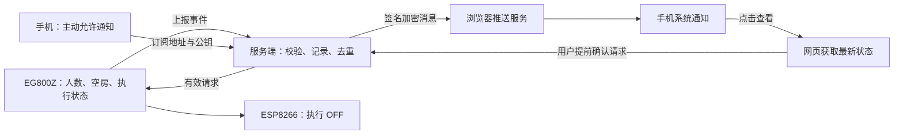

# 栖息：手机桌面与提醒方案

核对与实现日期：2026-11-06。

本次采用 **PWA（可添加到桌面的网页应用）**：继续使用现有网站和中文界面，补充图标、应用清单与缓存。用户从手机桌面打开即可进入栖息，不需要应用商店安装包。提醒分为页面弹窗、系统通知、后台远程推送，分别显示实现状态。

## 一、现在可以怎么用

网站：[打开栖息](https://qixi-dorm-ac-demo.beamygala1.chatgpt.site)。点击右上角铃铛，或首页“把栖息放到手机桌面 → 去设置”。

| 手机 | 添加到桌面的步骤 |
|---|---|
| iPhone / iPad | 用 Safari 打开 → 分享 → 添加到主屏幕 → 如有“作为 Web App 打开”则开启 → 添加 → 从“栖息”图标进入 |
| Android | 用 Chrome 打开 → 菜单 → 安装 / 安装并创建快捷方式 / 添加到主屏幕；浏览器提供安装事件时也可点击网站内“安装栖息” |
| 微信、QQ 内 | 先复制网址，在 Safari / Chrome 打开，再按对应步骤操作 |

菜单名称因版本而异；iPhone 的分享入口也会随标签页布局变化。依据：[Apple 添加桌面说明](https://support.apple.com/en-eg/guide/iphone/iphea86e5236/ios)、[Chrome 安装说明](https://support.google.com/chrome/answer/9658361?hl=zh-Hans&co=GENIE.Platform%3DAndroid)。

iPhone / iPad 的 Web Push 从 16.4 起支持已加入主屏幕的网页应用，通知授权需要由用户主动点击触发。本网站据此在普通 iOS 浏览器标签页中先显示安装指引，不直接申请权限；是否能启用还以运行时能力检测为准。[Apple WebKit 说明](https://webkit.org/blog/13878/web-push-for-web-apps-on-ios-and-ipados/)

## 二、三种提醒，分别做到哪一步

| 方式 | 本次状态 | 使用条件与限制 |
|---|---|---|
| 页面内优先弹窗 | 已实现 | 网页打开，空房计时开始后提醒；可提前确认，不确认到点自动执行 |
| 手机 / 电脑系统通知 | 已实现授权、测试与演示事件通知 | 浏览器支持、用户允许且开启演示通知；由仍在运行的网页发起 |
| 锁屏或关闭网页后的宿舍远程提醒 | 尚未接入 | 后续需要真实设备事件、服务端与 Web Push 订阅 / 推送 |

测试通知通过 Service Worker 的 `showNotification()` 提交。用户拒绝授权时提供设置引导；未支持、未从桌面打开、组件加载失败都有明确状态。提示“已提交给系统”不等于用户一定看到了横幅，展示受系统设置影响。[通知 API 说明](https://developer.mozilla.org/en-US/docs/Web/API/ServiceWorkerRegistration/showNotification)

不能把网页 `setTimeout`、安装图标或缓存当作可靠的锁屏倒计时。Service Worker 也会被浏览器停止，后台消息需要相应事件唤醒。现有页面时钟被系统挂起时，演示会延迟；真实自动关机继续由 EG800Z 负责。[后台运行与推送机制](https://developer.mozilla.org/en-US/docs/Web/Progressive_web_apps/Guides/Offline_and_background_operation)

## 三、实际实现

- `manifest.webmanifest`：应用名称、固定 ID、作用域、独立窗口模式、启动网址、192 / 512 图标与 maskable 图标。
- `icons/`：沿用栖息图形，添加 PNG 和 Apple 180 图标；没有引入外部图片服务。
- `sw.js`：首次联网时缓存固定演示文件；网络失败可用缓存打开。只缓存演示资源，不收集设备或账户数据。更新不会强制刷新正在运行的演示。
- `phone.js`、`phone.css`：按平台选择安装教程、复制链接、安装入口、权限检测、用户主动授权、测试通知、关闭演示通知、故障排查与官方资料。
- `phone-support.js`：能力判断、每轮空房通知去重、异步发送完成后的失效检查与清理。
- `app.js`：铃铛、首页入口、使用指南入口及模拟状态通知。新手引导结尾也说明去哪里设置。

安装按钮只在浏览器实际提供 `beforeinstallprompt` 时出现；用户取消后不把结果显示成已安装。此事件主要在 Chromium 浏览器实现，iPhone 使用菜单步骤。[安装事件说明](https://developer.mozilla.org/en-US/docs/Web/Progressive_web_apps/How_to/Trigger_install_prompt)

系统通知内容标记为“模拟”，每轮空房最多自动发一次；条件失效或开始执行后清除旧提醒。点击通知只打开 / 聚焦网页，再显示当前状态，**不会直接执行 OFF**。提醒关闭、授权拒绝或发送失败均不改变原有本地关机规则。网页的最高优先级只约束页面内部，不代表系统级强提醒权限。

首次联网且缓存成功后可离线浏览演示；系统可能清理缓存。重新打开或刷新会重置模拟人数，本地偏好按浏览器存储恢复。桌面应用与浏览器之间、不同设备之间的设置是否共享，不作保证。

## 四、以后接入真实后台提醒的路径

以下是后续实施设计，当前网站没有创建推送订阅或发送远程消息。

建议按三步推进：

1. **设备事件与订阅归属。**先确认“本轮空房”的标识、开始时间、截止时间及取消原因；把手机订阅关联到有权限的宿舍成员。推送私钥留在服务端。
2. **推送与失效处理。**用户主动订阅；服务端按事件发送，设短有效期并去重；删除失效订阅。用户取消订阅后停止投递。通知尽量简短，锁屏内容避免包含成员身份。
3. **真实联调。**在真实 Android 和 iPhone 上测试前台、后台、锁屏、完全关闭、断网恢复、拒绝与撤销权限。点击迟到通知只能读取当前状态，不能重放旧执行许可。

服务端使用标准 Web Push，把加密消息提交给浏览器推送服务，再由浏览器唤起 Service Worker 显示通知。推送依赖网络及系统策略，可能延迟；自动关机不应等待手机收件或确认。[Web Push 流程](https://developer.mozilla.org/en-US/docs/Web/Progressive_web_apps/Guides/Offline_and_background_operation#push)

## 五、本次验证与仍需人工验证

自动检查已经完成：

- 56 项 Node 测试通过，含 iOS 安装前置条件、授权状态、空房事件去重、取消竞态、通知点击不执行关机及图标实际尺寸。
- Edge 浏览器真实注册 Service Worker、缓存 17 个资源、断网后重新打开成功。
- 浏览器授权后实际调用系统通知 API，读取到测试通知，模拟空房可发提醒，进入事件后旧提醒被清除。
- 模拟 iPhone / Android / 应用内浏览器、拒绝权限、不支持通知、独立窗口和安装提示取消等状态。
- 回归首次引导、4 / 6 人寝、时长、提前确认、自动到点、学习流程。五页通过手机宽度检查，未捕获页面 JavaScript 错误。

**实体手机尚未实测。**桌面浏览器的移动视口和环境模拟不能证明真机安装、系统横幅或锁屏送达。用户可按页面教程安装，然后点击一次“发送测试通知”；后台宿舍推送还需完成上述后续接入。
