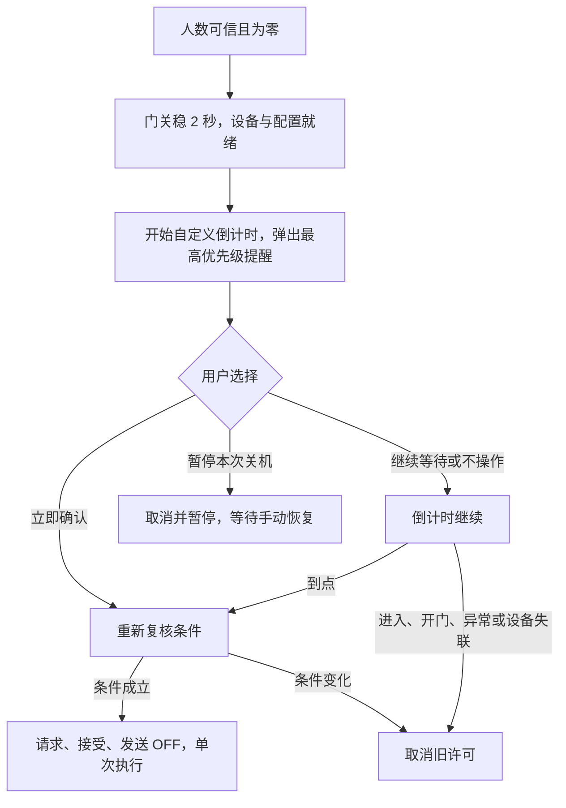

# 栖息：演示网站设计与交付说明 v3

> 历史网页设计记录。现行网页固定等待 900 秒，所有关机均为模拟。当前用法见 [网页 README](../../web/README.md)。

更新日期：2026-11-06。

本次重点是第一次使用、房间设置、红外教程、关机提醒及手机交互。根据最新要求，规则统一为：**空房等待期间可以人工提前确认；未确认则到预设时间自动关机。** 不再保留“必须人工确认才能执行”或“人工确认超时后不执行”的旧体验。

在线地址：[打开栖息](https://qixi-dorm-ac-demo.beamygala1.chatgpt.site)

## 1. 新手引导与设置

第一次进入需完成三步引导；完成前模拟时钟不运行，不能通过 Escape 或点背景跳过。

| 步骤 | 操作及响应 |
|---|---|
| 确认房型 | 选择 4 人寝或 6 人寝；房间示意、成员列表与文字同步变化 |
| 红外教程 | 模拟按遥控器 OFF，展示收码动画，说明两次采集、独立 OFF 验证与发射头安装 |
| 等待时间 | 常用值 5 / 10 / 15 / 30 分钟，或输入 1～60 的整数分钟，默认 15 分钟 |

右上角设置和侧栏房间卡可以修改设置、重看引导。首次必须完成，之后重看可以关闭。浏览器本地保存房型、时长及引导完成状态；损坏或旧版本数据回退到首次设置。禁用本地存储时提示仅本次生效。

房型代表床位容量，不代表当前实际人数。切为 6 人寝不会把 3 人在寝改成 6 人。示意头像只帮助展示人数，不表示红外能够识别人或确定室内位置。

修改设置会作废尚未执行的旧任务，重新判断条件并从完整的新时长计时；正在发射时不能改设置。已完成的同轮空房不会因改设置再次发送。

## 2. 提前确认与自动执行



提醒使用原生 `dialog.showModal()` 和 `role="alertdialog"`，在页面内覆盖普通弹窗、抽屉和导航。正在编辑设置时，提醒置于上层，收起后保留未提交内容。三种操作：

- **立即确认关机：**等待期间提前请求执行，重新验证空房和设备条件。
- **继续等待，到点自动关机：**关闭提醒但保留倒计时；按 Escape 也是此含义。
- **暂停本次关机：**明确取消并暂停；手动恢复后重新计时。

不操作时倒计时仍继续，到点自动执行并关闭提醒。每轮空房自动提醒一次，避免每秒重新弹出；流程卡片可以再次打开。条件失效时退出提醒，旧确认不可用。执行开始后不能撤回已发出的信号。

这是页面内最高优先级提醒。v3 另外增加可选的系统演示通知，详情见下文；浏览器演示不能替代真实设备的可靠计时和最终决策。

## 3. 页面与场景

暖白与深绿色界面；桌面左导航、手机底部导航。关键状态同时包含文字、图标及颜色。

| 页面 | 主要内容 |
|---|---|
| 宿舍总览 | 人数、4 / 6 床位示意、空调、自动流程、提前确认、暂停、动态 |
| 人员感知 | A / B 轨迹、通行表、门磁、歧义与校准 |
| 空调与学习 | 等待规则、设置入口、配置记录、六步模拟学习及重试 |
| 设备管理 | 主控、执行器、网络与模拟观察器，支持断线、恢复、重启 |
| 事件记录 | 分类、搜索、导出 JSON、最近命令与重复提交演示 |

首用教程帮助理解操作，不等于实际配对。完整六步学习保留在“空调与学习”：两次捕获、三种 OFF 观察、保存；完成后人数未知，需校准。

演示控制台包括有人在寝、最后一人离开、即将关机、提前确认、通行歧义、离线、发射失败、反馈超时和执行许可过期。支持 1× / 15× / 60×、暂停时钟和时间推进。

“提前确认”预设剩余 1 分钟，“即将关机”预设剩余 10 秒，方便快速演示；正常空房流程按保存的完整时长等待。切换场景重置演示状态，保留偏好。

异常处理沿用原设计：人数不可信停止执行；主控重启或重新连接后要求校准；执行器失联取消待执行；平台断网只影响模拟网络，不停止本地规则推演；发射失败或反馈未知不自动补发；重复命令不重复发射。执行许可的 2 秒有效期与人工确认等待时间无关。

## 4. 代码与后续接入

使用静态 HTML / CSS / JavaScript，无运行时第三方依赖、构建步骤或后端。文件都在仓库的 `web/dist/`。

```text
app.js：页面、设置、优先提醒及完整学习流程
  ├─ setup-ui.js：三步引导及共享设置组件
  ├─ preferences.js：设置校验和浏览器保存
  └─ store.js：模拟状态、计时、日志及执行过程
```

页面从同一份状态读取人数和倒计时；确认与到点共享执行流程，避免重复发送。每轮空房有独立标识，旧确认不会用于新一轮。

已有 仓库中的 `firmware/eg800z/` 与 `firmware/esp8266/` 未修改。真实固件仍使用原有 900 秒规则；本次自定义时间和提前确认仅在网页模拟器实现。正式联调需要可信设备或服务端支持这些请求，不能由浏览器决定真实执行许可。

后续保留页面、样式和学习说明，替换模拟状态源。本次不扩展 API、数据库、账户系统或真实设备入口，按用户要求集中于 UI 与交互。

## 5. 验收记录

2026-11-06 在本机完成：

- **40 项 Node 测试全部通过。**覆盖原有计数、900 秒、学习和异常，以及偏好保存、6 人寝、定制时长、改设置作废旧计时、提前确认、手动 / 自动临界去重、暂停和条件失效。
- **Edge + Playwright 交互通过。**首次强制引导、模拟收码、7 分钟保存、刷新保留、4 / 6 切换，提前确认、完全不操作时到点自动执行、继续等待、Escape、主动暂停。
- 检查优先提醒覆盖普通设置弹窗，关闭后保留编辑内容；重设时长创建完整新倒计时。
- 回归完整六步学习和事件搜索；无浏览器 JavaScript 运行错误。
- 五页在 **1440、390、360px** 宽度下无横向溢出；另检查手机设置、提醒和重看引导。
- 截图检查桌面六人寝、红外教程、首用引导、电脑及手机优先提醒。

这些是网页测试，不是红外实测或真实空调关机验收。Safari、实体手机和屏幕阅读器未专项实测。人数和日志刷新后重置，偏好保留；不同浏览器不自动同步。


## 6. v3：手机桌面与提醒

右上角铃铛和首页新增入口，提供分平台安装步骤、浏览器能力检测、通知授权与测试、关闭演示通知和排查说明。应用清单、图标及 Service Worker 已实现，支持缓存后的离线演示。

当前系统通知由运行中的网页发送；远程后台推送尚未接入。点击通知只返回页面查看，不直接执行空调命令。详细实现、来源和后续接入路径见 [手机桌面与提醒方案](手机桌面与提醒方案.md)。

本次共 56 项 Node 测试通过。浏览器验证真实缓存、离线重开、通知提交 / 读取 / 清除，以及移动界面与能力降级；iPhone / Android 的系统界面仍需实体手机实测。
